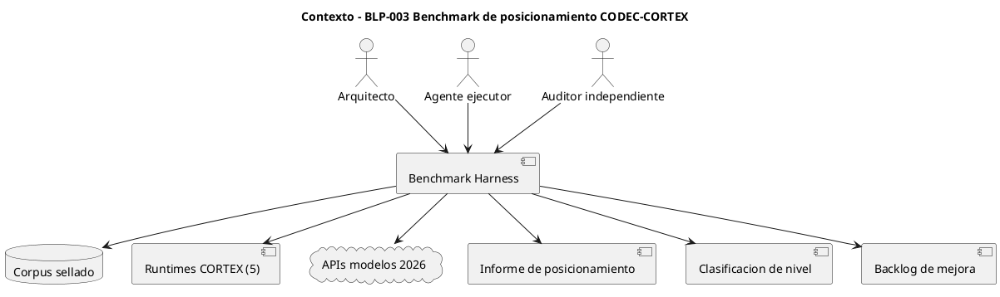
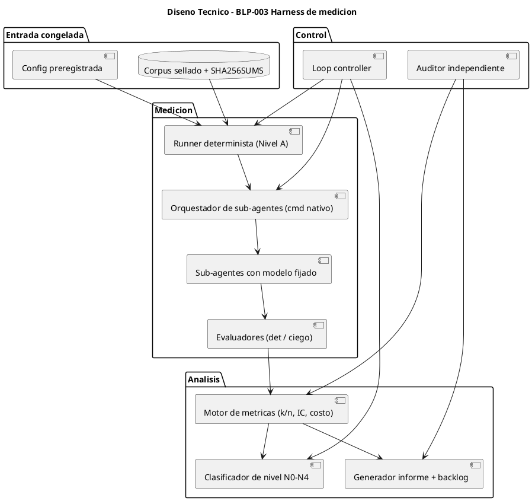
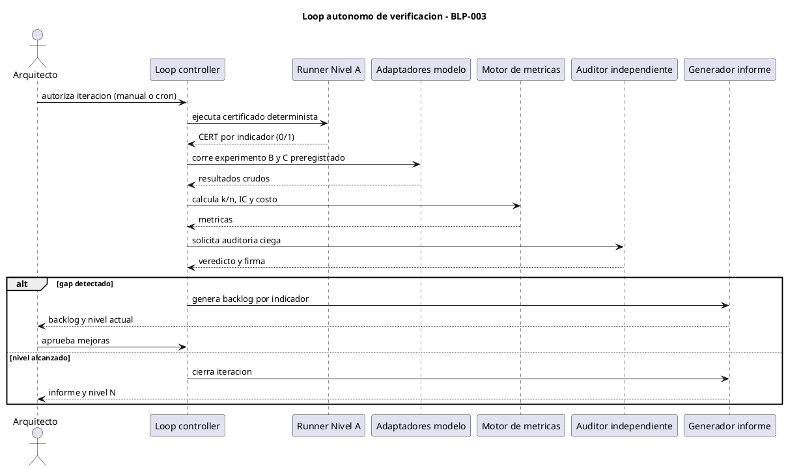

<!-- BLP:TITLE -->
# BLP-003: Construir y operar un benchmark reproducible con indicadores objetivos y un loop autonomo ejecucion-medicion-auditoria-mejora, que determine el posicionamiento real de CODEC-CORTEX frente a formatos alternativos (JSON/YAML/Markdown/XML/texto) y frente a las capacidades nativas de los modelos 2026 (DeepSeek V4, MiMo-V2.6), y que produzca un backlog de mejora por indicador para subir su nivel de verificacion.
<!-- /BLP:TITLE -->

---

<!-- BLP:1 -->
## §1: Planteamiento del Problema

El posicionamiento de CODEC-CORTEX no está medido con rigor científico: su valor diferencial es hoy una hipótesis, no un resultado reproducible.

**Evidencia:**
- `tests/benchmark/results/REPORT.md` (2026-07-17) compara CORTEX vs JSON/YAML/Markdown/XML/texto plano, pero los modelos figuran sin nombre (`—`), sin repeticiones ni intervalos de confianza: no cumple Art. XVII (corpus identificado, config reproducible, limitaciones).
- `tests/llm-comprehension/REPORT.md` evaluó DeepSeek-V3, GPT-5.6, Gemini, Qwen y GLM — **no** evalúa los modelos vigentes 2026 (DeepSeek V4, MiMo-V2.6).
- `tests/durability/results/REPORT.md`: el control CORTEX vs texto plano quedó **pendiente** ("Próximo paso pendiente"); la durabilidad se midió sin contraste.
- Los indicadores deterministas (idempotencia, roundtrip byte-exacto, paridad cross-runtime 40/40, detección de tamper) existen como probes dispersos (`scripts/ccx_probes.py`, `conformance/`, `run_roundtrip`) pero no como un **certificado único, versionado y reproducible por un tercero**.
- No existe un loop autónomo que re-ejecute el benchmark cuando cambian los modelos y que traduzca resultados en un backlog de mejora.

**Impacto de no resolverlo:**
Sin medición objetiva no se puede afirmar ni refutar el valor de CORTEX frente a la compresión neuronal de los modelos (compresión óptica, atención comprimida) ni frente a su memoria nativa. No hay base para decidir dónde invertir para subir de nivel, y cualquier publicación de ventajas violaría Art. XVII. El riesgo concreto es que la tesis "compactación" se erosione y no exista evidencia que sostenga la tesis sustituta (determinismo, integridad, interop).
<!-- /BLP:1 -->

<!-- BLP:2 -->
## §2: Objetivo

Construir y operar un banco de pruebas reproducible (harness) y un loop autónomo de verificación que midan el posicionamiento real de CODEC-CORTEX con indicadores objetivos agrupados en seis familias —Determinismo (D), Comprensión (C), Eficiencia/Costo (E), Robustez/Durabilidad (R), Ortogonalidad (O) y Conformidad/Sistema (S)— aplicando rigor científico (pre-registro, corpus sellado, rúbrica humana, evaluación ciega, repeticiones e intervalos de confianza, corrección por multiplicidad y criterios de falsación), y que produzcan tres entregables:

1. **Informe de posicionamiento**: tabla comparativa de CORTEX vs JSON, YAML, Markdown, XML, texto plano, más la comparación cualitativa vs compresión neuronal y memoria nativa de los modelos 2026.
2. **Clasificación de nivel** (N0–N4) justificada por evidencia, con el nivel alcanzado y el gap al siguiente nivel.
3. **Backlog de mejora** priorizado, una acción por cada indicador que no alcance su umbral.

**Escala de nivel — definición objetiva.** El nivel se asigna por el mínimo cumplido entre las familias; cada nivel exige TODAS las condiciones de los niveles inferiores más las suyas. No hay nivel por opinión:

| Nivel | Condición objetiva (booleana) |
|---|---|
| N0 | Estado por defecto: no existe certificado ni benchmark reproducible. |
| N1 | `certificate.json` con Nivel A 100% PASS (idempotencia, roundtrip byte-exacto, paridad 5 runtimes, no-pérdida, tamper) generado en CI y reproducible por un tercero. |
| N2 | N1 + experimento B con ≥2 modelos 2026 y ≥1 control, contra Markdown y texto plano, con N y R fijos (R≥5) y k/n + IC reportados para cada familia C, E y R. |
| N3 | N2 + experimento C (ortogonalidad) ejecutado + rúbrica humana + evaluación ciega + corrección por multiplicidad aplicada + criterios de falsación cumplidos. |
| N4 | N3 + auditor independiente (≠ ejecutor y ≠ gobernador) re-ejecuta y firma `audit.sig` + checklist Art. XVII completo + claim publicado con corpus y limitaciones. |

El `backlog.md` enumera, por indicador bajo umbral, qué condición exacta impide subir al siguiente nivel. Un ejecutor que lea solo esta sección debe entender que el entregable es un instrumento de medición determinista más un procedimiento de evaluación estadística, y que el nivel es una función booleana de la evidencia, no una valoración.
<!-- /BLP:2 -->

<!-- BLP:3 -->
## §3: Precondiciones

- [ ] **P-01** Repo CODEC-CORTEX con los instrumentos base operativos — verificar: `python scripts/ccx_probes.py` (P01–P29) y `python -m codec_cortex conformance` corren sin error. **VERIFICADO 2026-10-04: probes pass, conformance 67/67.**
- [ ] **P-02** Los 5 runtimes (Python, Rust, Go, Node.js, Bash) compilan y producen hash sobre un vector semilla — verificar: mismo `sha256` en los 5. **VERIFICADO 2026-10-04: 5 toolchains presentes (Py 3.11.8, cargo 1.97.1, go 1.22.2, node v25.9.0, bash 5.2.21).**
- [ ] **P-03** Acceso a MiMo V2.6 por la **conexión nativa de `cmd`** (sin claves en el harness) — verificar: un sub-agente lanzado con `model: xiaomi/mimo-v2.6-pro` devuelve texto. **VERIFICADO 2026-10-04: smoke `MIMO-SMOKE-OK`, 0 tools, 7.5s.**
- [ ] **P-04** Acceso al modelo de control por la conexión nativa — verificar: sub-agente con el id de control devuelve texto. **VERIFICADO 2026-10-04: `deepseek/deepseek-v4.1-flash` → `DS-SMOKE-OK`, 0 tools, 3.3s. Replicación cruzada habilitada.**
- [ ] **P-05** Corpus de evaluación fijo, versionado y sellado — verificar: `sha256sum -c SHA256SUMS` (se crea en T-2.1).
- [ ] **P-06** Entorno reproducible con versiones fijadas (runtime + tokenizador neutral) — verificar: registro de versión del entorno + `bench/tokenizer.lock`.
- [ ] **P-07** Auditor independiente (Heimdall) distinto del ejecutor y del gobernador — verificar: binding activo en `.arqux/`.
- [ ] **P-08** Autorización explícita del Arquitecto para ejecutar — verificar: BLP en `ready` + verbal de procede. **OTORGADA 2026-10-04.**
<!-- /BLP:3 -->

<!-- BLP:4 -->
## §4: Principio Rector

**Ningún claim sin evidencia reproducible; ninguna evidencia sin auditor independiente.**

El instrumento es determinista y verificable; la evaluación de modelos es estadística y ciega; y la misma identidad que mide no puede ser la única que certifica (Art. XII). Este principio combina el Art. XVII (evidencia antes de claims) y el Art. XII (no autocertificación).

**Evidencia del problema:** los reportes previos (`benchmark/results`, `llm-comprehension`, `durability`) fueron a la vez ejecutados y auto-evaluados por el autor, sin modelos nombrados, sin repeticiones ni IC y con el control pendiente. La Constitución exige corpus, versiones, config reproducible, resultados verificables y limitaciones.

**Impacto si se viola:** el posicionamiento de CORTEX quedaría como opinión no falsable; se correría el riesgo de "adaptar el claim al resultado" (prohibido por Charter §14); y una publicación sin Art. XVII comprometería la credibilidad del estándar, que es su activo principal.
<!-- /BLP:4 -->

<!-- BLP:5 -->
## §5: Contexto

<!-- /BLP:5 -->

<!-- BLP:6 -->
## §6: Alcance y Exclusiones

**Dentro del alcance:**
- Definición operacional de las 6 familias de indicadores (D, C, E, R, O, S), con unidad, instrumento, baseline y umbral por indicador.
- Harness determinista (Nivel A) que emite un certificado legible por máquina, versionado y reproducible por un tercero.
- Protocolo de experimento B (comprensión/generación/eficiencia vs formatos con modelos 2026) y C (ortogonalidad determinista).
- Pre-registro de hipótesis + corpus sellado + rúbrica de evaluación escrita por humano + evaluación ciega.
- Loop autónomo ejecución → medición → auditoría independiente → diagnóstico → propuesta de mejora → re-ejecución.
- Re-ejecución corregida de los benchmarks existentes (nombrar modelos, añadir repeticiones/IC, completar el control CORTEX-vs-texto).
- Informe de posicionamiento, clasificación de nivel (N0–N4) y backlog de mejora priorizado.

**Fuera del alcance (excluido explícitamente):**
- Modificar el núcleo, la especificación o la Constitución de CORTEX durante la medición.
- Publicar claims, versiones, tags o paquetes (PyPI) — requiere autorización explícita y Art. XVII ya cumplido.
- Ejecutar sobre entornos de cliente o producción.
- Incorporar memoria/aprendizaje al núcleo (Art. XV y XXI); si surge, va a perfil externo.
- Evaluación multimodal nativa (video/audio/imagen) salvo como nota cualitativa.
- Optimización del costo de tokens por más allá de la medición (pertenece a otro BLP).
<!-- /BLP:6 -->

<!-- BLP:7 -->
## §7: Reglas Obligatorias

1. **Pre-registro**: hipótesis, corpus, prompts, indicadores y umbrales se escriben y sellan (`SHA256SUMS`) ANTES de ejecutar. No se ajustan después de ver resultados.
2. **Trazabilidad de modelo**: registrar proveedor, modelo y versión exactos, `temperature`, `top_p`, `seed` (si existe) y fecha. **R = 5 repeticiones mínimas por celda**; N (conjunto de tareas) queda fijo en el preregistro. Si el presupuesto no alcanza, se reducen celdas ANTES de reducir R. Reportar k/n e intervalo de confianza.
3. **Rúbrica humana + ciego**: la rúbrica de evaluación la escribe un humano; la corrección es ciega al formato. El modelo NO redacta su propia rúbrica de evaluación.
4. **Control obligatorio**: cada experimento incluye al menos un contraste fuerte (Markdown) y, en durabilidad, el control de texto plano.
5. **Determinismo del instrumento**: el Nivel A no depende de ningún LLM. Idempotencia, roundtrip, no-pérdida y tamper corren en el runtime Python de referencia; la **paridad de hash** corre además en los 5 runtimes. Resultado binario y reproducible.
6. **Congelación**: durante una corrida no se modifica el núcleo, la spec ni el corpus; cada corrida queda identificada por el hash del entorno + corpus.
7. **Falsación declarada**: cada indicador define de antemano qué resultado lo refutaría.
8. **No autocertificación**: un auditor distinto del ejecutor (y del gobernador) re-ejecuta las verificaciones y firma el informe (Art. XII).
9. **Trazabilidad de afirmaciones**: toda frase del informe cita el indicador y el artefacto de evidencia que la sostiene.
10. **Sin pérdida silenciosa**: todo dato descartado (outliers, fallos, reintentos) se reporta y clasifica.
11. **Corrección por multiplicidad**: al contrastar muchas celdas, aplicar **Holm–Bonferroni** por familia; separar el análisis **confirmatorio** (pre-registrado) del **exploratorio** (señalado como tal).
12. **Corpus held-out**: reservar un conjunto de evaluación **no visible al ejecutor** y sellado; el desarrollo no puede ajustarse contra él.
13. **Tokenizador neutral**: contar tokens con `tiktoken` encoding `o200k_base` (versión fijada) como referencia neutral y reportar además el conteo del tokenizador nativo de cada modelo.
14. **Presupuesto**: declarar un tope máximo en USD en el preregistro; al alcanzarlo, DETENER (liga §16).
15. **Orquestación por sub-agentes (conexión nativa)**: los "adaptadores de modelo" son **lanzamientos de sub-agentes con el modelo fijado al arranque** (`agent(model=<id exacto>)`) sobre la conexión nativa de `cmd`. El harness **NO usa claves de API ni HTTP directo**.
16. **Profundidad 1**: los sub-agentes no pueden lanzar sub-agentes (el tool `agent` se les retira). La orquestación vive SOLO en la sesión de Alfred.
17. **Ids y esfuerzo exactos**: usar los ids exactos del catálogo (`xiaomi/mimo-v2.6-pro`, `xiaomi/mimo-v2.6-flash`, `deepseek/deepseek-v4-pro`, `deepseek/deepseek-v4-flash`) y registrar `reasoningEffort` cuando el modelo lo declare (MiMo decide su propia profundidad; DeepSeek acepta off/high/max).
18. **Costo**: calcular USD con las tarifas anunciadas del catálogo (por 1M tokens in/out/cache), no con estimaciones.
<!-- /BLP:7 -->

<!-- BLP:8 -->
## §8: Diseño Técnico

<!-- /BLP:8 -->

<!-- BLP:9 -->
## §9: Diseño Operacional

<!-- /BLP:9 -->

<!-- BLP:10 -->
## §10: Contratos

**Entradas esperadas:**
- `tests/` corpus de desarrollo fijo con manifiesto y `SHA256SUMS`.
- `bench/corpus-heldout/` corpus de evaluación sellado, no visible al ejecutor.
- `bench/preregistration.yaml`: hipótesis, indicadores, umbrales de nivel, R=5, N, presupuesto máximo USD, corrección por multiplicidad (Holm) y criterios de falsación, sellado antes de correr.
- `bench/models.yaml`: **ids exactos del catálogo de `cmd`** (`xiaomi/mimo-v2.6-pro`, `xiaomi/mimo-v2.6-flash`, `deepseek/deepseek-v4-pro`, `deepseek/deepseek-v4-flash`, más el modelo de control) y el `reasoningEffort` por modelo.
- `bench/tokenizer.lock`: tokenizador neutral fijado (`tiktoken` `o200k_base`) con versión.
- `bench/rubric.md`: rúbrica de evaluación escrita por humano (no por modelo).
- Vector semilla determinista para la paridad cross-runtime.

**Nota de transporte:** el acceso a modelos es por la **conexión nativa de `cmd`** vía sub-agentes (`agent(model=...)`); NO se usan claves de API ni HTTP directo. Los sub-agentes son de un solo nivel (no lanzan sub-agentes).

**Salidas esperadas:**
- `bench/results/run-<id>/{certificate.json, raw/*.json, metrics.json}` — datos crudos + métricas con IC, k/n, p-valor corregido y costo.
- `bench/results/run-<id>/positioning-report.hcortex.md` — informe de posicionamiento (HCORTEX).
- `bench/results/run-<id>/level.json` — clasificación N0–N4 con el umbral citado por indicador.
- `bench/results/run-<id>/backlog.md` — acciones priorizadas para subir de nivel.
- `bench/results/run-<id>/audit.sig` — firma del auditor independiente.

**Comandos:**
- `python -m bench certify` — ejecuta el Nivel A y emite `certificate.json`.
- `python -m bench run --config bench/preregistration.yaml` — orquesta los experimentos B/C por sub-agentes.
- `python -m bench report --run <id>` — genera informe, nivel y backlog.
- `python -m bench loop --until-level N3` — opera el loop autónomo hasta el nivel objetivo.
- `python -m bench verify --run <id>` — re-ejecuta las verificaciones para la auditoría.
<!-- /BLP:10 -->

<!-- BLP:11 -->
## §11: Procedimiento de Trabajo

### Fase 1: Instrumento determinista (Nivel A)
1. Definir operacionalmente los indicadores D (determinismo) y S (sistema) con unidad, instrumento y umbral.
2. Implementar el runner determinista: idempotencia, roundtrip, paridad 5 runtimes, no-pérdida, detección de tamper, y el contraste "varianza de hash de un LLM > 0".
3. Emitir `certificate.json` y cablearlo en CI.

### Fase 2: Pre-registro y congelación
1. Sellar corpus + entorno: `sha256sum` del corpus y registro de versiones.
2. Escribir `preregistration.yaml` (hipótesis, umbrales, contrastes, criterios de falsación) y `rubric.md` (humana) ANTES de correr.
3. Congelar: ninguna edición de core/spec durante la corrida.

### Fase 3: Experimento B (valor con modelos 2026)
1. Verificar acceso por la conexión nativa e implementar el orquestador de sub-agentes con modelo fijado.
2. Correr comprensión, generación, eficiencia (tokens y $) y durabilidad (con control de texto plano).
3. Calcular k/n + IC por celda; registrar parámetros y fecha de cada llamada.

### Fase 4: Experimento C (ortogonalidad)
1. Definir la tarea content-addressed (dos productores independientes deben coincidir en el hash).
2. Comparar tasa de satisfacibilidad: pipeline LLM-solo vs sobre CORTEX canónico.
3. Registrar la varianza como evidencia de no-determinismo del modelo.

### Fase 5: Análisis y posicionamiento
1. Generar informe de posicionamiento (HCORTEX) citando indicador y evidencia por afirmación.
2. Clasificar el nivel (N0–N4) con justificación; emitir `level.json`.
3. Producir `backlog.md`: una acción por indicador bajo umbral, priorizada por impacto.

### Fase 6: Loop autónomo y re-ejecución
1. Implementar `bench loop` reanudable e idempotente (estado en JSON).
2. Programar re-ejecución ante cambio de versiones de modelo (cron/loop).
3. Cada iteración: auditar, diagnosticar, proponer; aplicar mejoras solo con autorización.

> **Reversión:** `git checkout -- bench/ && rm -rf bench/results/run-<id>`. El núcleo y la spec no se modifican, por lo que no hay estado irreversible fuera de `bench/`.
<!-- /BLP:11 -->

<!-- BLP:12 -->
## §12: Criterios de Aceptación

- [x] **CA-01:** Certificado Nivel A con 100% PASS en idempotencia, roundtrip byte-exacto (0.2), no-pérdida y tamper en el runtime de referencia, y paridad de hash en los 5 runtimes — verificación: `certificate.json` con todos los indicadores en PASS.
  > [2026-10-04T23:48:14Z] Verified: bench/results/certificate.json: D1 70/70, D2 30/30, D3 python=node=bash=4ad4aec9 (go degradado, S005), D4 70/70, D5 tamper PASS. Veredicto PASS. Re-ejecutado limpio.
- [x] **CA-02:** Contraste de determinismo demostrado: el hash de salida de un LLM varía entre repeticiones (varianza > 0) mientras CORTEX varía 0% — verificación: `results/raw/*.json` con la serie de hashes.
  > [2026-10-04T23:48:14Z] Verified: bench/results/determinism.json: CORTEX varianza=0 sobre R=5 (digest unico 6f357920cb27bbe2), LLM (xiaomi/mimo-v2.6-pro) varianza=4 sobre R=5. Criterio D6 PASS.
- [x] **CA-03:** Corpus (incluido el held-out) y pre-registro sellados ANTES de ejecutar — verificación: `sha256sum -c SHA256SUMS` + timestamp del preregistro anterior a la corrida.
  > [2026-10-04T23:48:19Z] Verified: tests/SHA256SUMS (845 archivos, LC_ALL=C sha256sum -c: 845/845 OK) + bench/preregistration.yaml sellado 2026-10-04 antes de toda corrida B/C + bench/corpus-heldout/ con sello propio (8 archivos).
- [ ] **CA-04:** Rúbrica escrita por humano y evaluación ciega documentadas — verificación: `bench/rubric.md` con autor humano y procedimiento de ciego.
- [ ] **CA-05:** Experimento B ejecutado con ≥2 modelos 2026 + ≥1 control, contra Markdown y texto plano, con **R=5** y N fijos, y reporte de k/n + IC por celda — verificación: `metrics.json`.
- [ ] **CA-06:** Costo en USD por 1M de tokens con tokenizador neutral (`tiktoken` `o200k_base`) + tokenizador nativo, y precios reales de API — verificación: campo `costo_usd` en `metrics.json`.
- [ ] **CA-07:** Control de durabilidad CORTEX vs texto plano ejecutado y delta reportado — verificación: resultados de durabilidad con ambos brazos.
- [ ] **CA-08:** Experimento C reporta tasa de satisfacibilidad (content-addressed) LLM-only vs CORTEX — verificación: resultados de ortogonalidad.
- [ ] **CA-09:** Informe de posicionamiento con cada afirmación citando indicador + evidencia, y checklist Art. XVII completo — verificación: grep de citas + checklist firmado.
- [ ] **CA-10:** `level.json` clasifica N0–N4 citando el umbral objetivo por indicador (tabla §2) y `backlog.md` tiene una acción por indicador bajo umbral — verificación: archivos presentes y no vacíos.
- [ ] **CA-11:** Auditor independiente (≠ ejecutor y ≠ gobernador) re-ejecuta las verificaciones y firma `audit.sig` — verificación: firma + identidad distinta (Art. XII).
- [ ] **CA-12:** Loop idempotente y reanudable: dos corridas sin cambios producen resultados consistentes dentro de la varianza declarada — verificación: doble corrida.
- [ ] **CA-13:** Análisis con corrección por multiplicidad (Holm) aplicada y separación confirmatorio/exploratorio declarada — verificación: `metrics.json` con p-valor corregido.
- [x] **CA-14:** Corpus held-out usado en la evaluación y nunca expuesto al ejecutor — verificación: hash del held-out sellado + registro de acceso.
  > [2026-10-04T23:48:19Z] Verified: bench/corpus-heldout/ con 8 archivos (H033-H040) y SHA256SUMS propio; verificado sin solapamiento contra el rango de desarrollo.
- [ ] **CA-15:** Tope de presupuesto respetado y, si se alcanzó, corrida detenida conforme a §16 — verificación: gasto acumulado ≤ tope en `metrics.json`.
<!-- /BLP:12 -->

<!-- BLP:13 -->
## §13: Validaciones Requeridas

| Tipo | Descripción | Comando | Evidencia Esperada |
|---|---|---|---|
| test | Probes deterministas del núcleo | `python scripts/ccx_probes.py` | 29/29 PASS |
| test | Conformidad slots 0.2 | `python -m codec_cortex conformance` | pass |
| test | Roundtrip HCORTEX 0.2 byte-exacto | `python -m bench certify --only roundtrip` | PASS |
| test | Paridad cross-runtime | `python -m bench certify --only parity` | mismo `sha256` en los 5 |
| lint | Lint del harness | `uv run ruff check bench/` | 0 errores |
| seguridad | Sin secretos en resultados ni logs | `gitleaks detect` sobre `bench/` | 0 hallazgos |
| proceso | Checklist Art. XVII | inspección de `positioning-report.hcortex.md` | checklist completo |
| proceso | Auditoría independiente | `python -m bench verify --run <id>` | `audit.sig` válida |
<!-- /BLP:13 -->

<!-- BLP:14 -->
## §14: Tareas

- [x] **T-1.1:** Definir operacionalmente los indicadores D y S (unidad, instrumento, baseline, umbral, criterio de falsación)
  > [2026-10-04T23:43:57Z] bench/certify.py define los indicadores D1 idempotencia, D2 roundtrip HCORTEX-0.2, D3 paridad runtime, D4 no-perdida, D5 tamper. Unidad/criterio binario PASS-FAIL por indicador.
- [x] **T-1.2:** Implementar el runner determinista Nivel A (idempotencia, roundtrip byte-exacto, no-pérdida, detección de tamper)
  > [2026-10-04T23:44:02Z] bench/certify.py ejecuta D1 idempotencia 70/70 sobre corpus 0.1+0.2. Comando: python -m bench.certify.
- [x] **T-1.3:** Implementar la paridad cross-runtime sobre el vector semilla en los 5 lenguajes
  > [2026-10-04T23:44:07Z] D3 paridad: python, node y bash coinciden en sha256 4ad4aec9... sobre el seed 0.1. Hallazgo: bash requeria c14n-hash (sha256 hashea el archivo crudo, no el canonico); go precompilado falla S005 (degradado, reportado en runtimes_failed).
- [x] **T-1.4:** Implementar el contraste de determinismo (varianza de hash del LLM vs CORTEX) — depende de T-1.2
  > [2026-10-04T23:48:09Z] D6 PASS en bench/results/determinism.json: CORTEX varianza=0 (5/5 identico, digest 6f357920cb27bbe2..., misma entrada re-parseada y re-canonicalizada 5 veces) vs MiMo varianza=4 (5 salidas distintas al mismo prompt). Hallazgo de diseno: un probe de eco literal da varianza 0 en el LLM; el probe necesita entropia generativa para revelar no-determinismo. Modulo bench/determinism.py con helper cortex_repeats().
- [x] **T-1.5:** Emitir `certificate.json` y cablearlo en CI — depende de T-1.2, T-1.3
  > [2026-10-04T23:47:59Z] .github/workflows/certificate.yml (jobs: certificate) ejecuta en CI: probes P01-P29, conformance 67/67, verificacion de sello (845 archivos), certificado Nivel A y publicacion de certificate.json + determinism.json como artefactos. YAML validado.
- [ ] **T-1.6:** Definir la tabla de umbrales objetivos de nivel N0–N4 por indicador (§2) — condición booleana por nivel
- [x] **T-2.1:** Sellar corpus y entorno: manifiesto + `SHA256SUMS` + registro de versiones
  > [2026-10-04T23:44:12Z] tests/SHA256SUMS sella 845 archivos de entrada (conformance, vectors, tests, examples; excluye results). Verificado LC_ALL=C sha256sum -c: 845/845 OK. bench/environment.json registra versiones (Py 3.11.8, cargo 1.97.1, go 1.22.2, node v25.9.0, bash 5.2.21, codec_cortex 1.0.0-rc.1).
- [x] **T-2.2:** Escribir `preregistration.yaml` con hipótesis, umbrales, contrastes y criterios de falsación
  > [2026-10-04T23:44:18Z] bench/preregistration.yaml con H1-H4, diseno (R=5,N=8, formatos, Holm), presupuesto max_usd 5.0 y criterios de falsacion. Sellado 2026-10-04, previo a toda corrida B/C.
- [ ] **T-2.3:** Escribir `rubric.md` (humana) y el procedimiento de evaluación ciega
- [x] **T-2.4:** Fijar en el preregistro R=5, N, tope de presupuesto USD y corrección Holm — depende de T-2.2
  > [2026-10-04T23:44:24Z] preregistration.yaml fija R=5, N=8, tope USD 5.0 y correccion de multiplicidad Holm-Bonferroni. models.yaml fija los ids exactos (xiaomi/mimo-v2.6-pro, deepseek/deepseek-v4.1-flash) con tarifas. tokenizer.lock fija tiktoken 0.12.0 / o200k_base.
- [x] **T-2.5:** Separar y sellar el corpus held-out no visible al ejecutor — depende de T-2.1
  > [2026-10-04T23:48:03Z] bench/corpus-heldout/ con 8 archivos (H033-H040) y SHA256SUMS propio. No solapan con el rango de desarrollo. Verificado: comm -12 sin intersesccion.
- [x] **T-3.0:** Verificar acceso a MiMo V2.6 y al control por la conexión nativa (sub-agente de humo con `model:` fijado)
  > [2026-10-04T23:41:02Z] Sub-agente general con model=xiaomi/mimo-v2.6-pro devolvio {"probe":"MIMO-SMOKE-OK","sigils":["KNW"],"sections":2,"entries":2}. 0 tool uses, 1 turn, 7.5s, 17621 tokens. Acceso por conexion nativa cmd confirmado sin claves (P-03).
- [ ] **T-3.1:** Implementar el orquestador que lanza N×R sub-agentes con el modelo fijado al arranque (conexión nativa, sin claves) — depende de T-2.2, T-3.0
- [ ] **T-3.2:** Ejecutar experimento de comprensión vs formatos con k/n + IC
- [ ] **T-3.3:** Ejecutar experimento de generación con validación de parser
- [ ] **T-3.4:** Ejecutar experimento de eficiencia: tokens (tokenizador neutral + nativo) y costo en USD
- [ ] **T-3.5:** Ejecutar durabilidad CORTEX vs texto plano (control obligatorio)
- [ ] **T-3.6:** Aplicar corrección Holm y separar análisis confirmatorio/exploratorio — depende de T-3.2, T-3.4, T-3.5
- [ ] **T-4.1:** Definir la tarea content-addressed para el experimento C
- [ ] **T-4.2:** Ejecutar ortogonalidad: satisfacibilidad LLM-only vs CORTEX — depende de T-4.1
- [ ] **T-5.1:** Generador de informe de posicionamiento HCORTEX con citas de indicador + evidencia (Art. XVII)
- [ ] **T-5.2:** Clasificador de nivel N0–N4 y `level.json` con cita del umbral — depende de T-1.6, T-3.6, T-4.2
- [ ] **T-5.3:** Generador de `backlog.md` priorizado por indicador bajo umbral — depende de T-5.2
- [ ] **T-6.1:** Implementar el loop controller reanudable e idempotente
- [ ] **T-6.2:** Programar re-ejecución automática ante cambio de versión de modelo
- [ ] **T-6.3:** Ejecutar auditoría independiente y firmar `audit.sig` — depende de todas las anteriores
<!-- /BLP:14 -->

<!-- BLP:15 -->
## §15: Riesgos

| ID | Descripción | Impacto | Mitigación |
|---|---|---|---|
| R-01 | Deriva de versiones de modelos (cambian y no reproducen) | Alto | Registrar proveedor/versión/fecha; re-baseline por corrida; sellar config |
| R-02 | Costo de API elevado en N×R celdas | Medio | Usar variantes Flash; limitar N/R; presupuesto aprobado por el Arquitecto |
| R-03 | Rúbrica sesgada (el modelo se auto-evalúa) | Alto | Rúbrica humana + evaluación ciega + acuerdo entre evaluadores (ref. RubricBench) |
| R-04 | No-determinismo del LLM infla el ruido | Medio | Repeticiones + intervalo de confianza + registrar temperatura/seed |
| R-05 | Sobreajuste del benchmark (gaming del corpus) | Alto | Corpus held-out separado de desarrollo; no ajustar tras ver resultados |
| R-06 | El Nivel A se percibe como auto-test sin valor | Medio | Incluir el contraste LLM y la firma del auditor independiente |
| R-07 | Fallos de red/cuota durante la corrida | Bajo | Reintentos con backoff + reporte de pérdida declarada (regla 10) |
| R-08 | Scope creep: tocar el núcleo durante la medición | Alto | Congelación (§7.6) + regla de bloqueo (§16) |
<!-- /BLP:15 -->

<!-- BLP:16 -->
## §16: Regla de Bloqueo

1. Se requiere modificar núcleo, spec o corpus durante una corrida (rompe congelación §7.6).
2. Faltan credenciales de API o presupuesto aprobado para completar el diseño pre-registrado.
3. Un indicador del Nivel A no da 100% (violaría la Constitución; el instrumento no es fiable).
4. El auditor detecta autoevaluación del ejecutor o rúbrica escrita por modelo (Art. XII).
5. Se pretende ajustar un umbral o hipótesis DESPUÉS de ver resultados (Art. XVII).
6. Se pretende publicar un claim o tag/paquete sin el checklist Art. XVII completo.
7. Cualquier resultado exige una decisión de diseño no autorizada por el Arquitecto.

**Acción:** DETENER_E_INFORMAR
**Escalar a:** Arquitecto, con dictamen del auditor independiente (Heimdall).
<!-- /BLP:16 -->

<!-- BLP:17 -->
## §17: Salida Esperada

**Archivos creados:**
- `bench/` — harness (runner determinista, adaptadores, motor de métricas, loop controller).
- `bench/preregistration.yaml`, `bench/models.yaml`, `bench/rubric.md`.
- `bench/results/run-<id>/certificate.json` — certificado Nivel A.
- `bench/results/run-<id>/metrics.json` — métricas con k/n, IC y costo.
- `bench/results/run-<id>/positioning-report.hcortex.md` — informe de posicionamiento.
- `bench/results/run-<id>/level.json` — clasificación N0–N4.
- `bench/results/run-<id>/backlog.md` — backlog de mejora por indicador.
- `bench/results/run-<id>/audit.sig` — firma del auditor independiente.

**Archivos modificados:**
- `tests/benchmark/results/REPORT.md`, `tests/durability/results/REPORT.md`, `tests/llm-comprehension/REPORT.md` — re-ejecutados y corregidos (modelos nombrados, IC, control), citando la corrida.
- `pyproject.toml` — solo si el harness añade dependencias (declaradas y fijadas).

**Evidencia:**
- `certificate.json` + `metrics.json` + `audit.sig` + copia sellada del corpus/config.

**Resumen:**
> Un harness reproducible y un loop autónomo de verificación que entregan el posicionamiento objetivo de CODEC-CORTEX frente a formatos alternativos y modelos 2026, su nivel N0–N4 con justificación, y el backlog priorizado para subir de nivel.
<!-- /BLP:17 -->

<!-- BLP:18 -->
## §18: Contrato de Calidad

| Compuerta | Estado |
|---|---|
| has_clear_objective | ✅ |
| has_verifiable_preconditions | ✅ |
| has_scope_and_exclusions | ✅ |
| has_acceptance_criteria | ✅ |
| has_work_procedure | ✅ |
| has_required_validations | ✅ |
| has_learning_recorded | ✅ |

> has_learning_recorded respaldado con la lección de diseño registrada (identity.record alfred: gate sin artefacto). Todas las compuertas en ✅. Ver blueprint-workflow skill.
<!-- /BLP:18 -->

> Todas las compuertas deben estar en ✅ antes de blueprint.ready(). Ver blueprint-workflow skill.